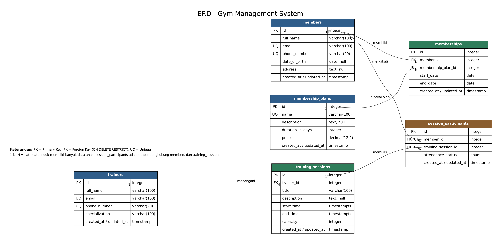
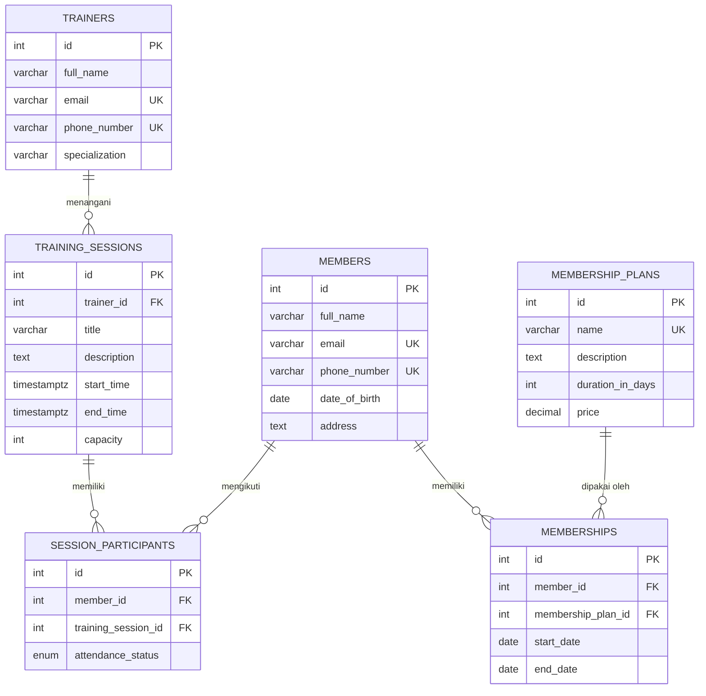

# ERD - Gym Management System

Gambar: [`erd.png`](./erd.png) (sumber: `erd.dot`, dibuat dengan Graphviz: `dot -Tpng -Gdpi=150 erd.dot -o erd.png`).

Versi Mermaid (otomatis tampil sebagai diagram di GitHub / VS Code dengan ekstensi Mermaid):

Setiap tabel juga memiliki `created_at` dan `updated_at`.

## Catatan relasi

| Relasi | Kardinalitas | Foreign Key | Aturan hapus |
|---|---|---|---|
| members → memberships | 1 : N | `memberships.member_id` | RESTRICT |
| membership_plans → memberships | 1 : N | `memberships.membership_plan_id` | RESTRICT |
| trainers → training_sessions | 1 : N | `training_sessions.trainer_id` | RESTRICT |
| training_sessions → session_participants | 1 : N | `session_participants.training_session_id` | RESTRICT |
| members → session_participants | 1 : N | `session_participants.member_id` | RESTRICT |
| members ↔ training_sessions | N : M | lewat `session_participants` | - |

- `RESTRICT`: data induk tidak dapat dihapus selama masih dipakai data anak (API menjawab 409).
- `session_participants` memiliki unique constraint gabungan `(member_id, training_session_id)`: satu member hanya bisa terdaftar sekali pada satu sesi.
- Status membership (`UPCOMING`/`ACTIVE`/`EXPIRED`) **tidak** disimpan, tetapi dihitung dari `start_date` dan `end_date`.
